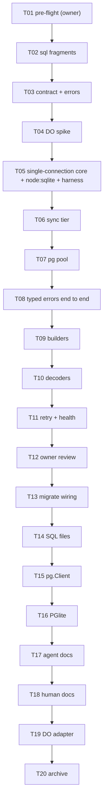

<!--
GENERATED ANALYSIS — @marianmeres/sqlkit v0 foundation
Produced 2026-11-18 by inline research → owner interview (two rounds) → verification.
Claims verified against the prior-art snapshot in tmp/prior-art/ (sources and commits in its
README), node:sqlite on Node 26.13.1, and the Cloudflare Durable Objects SQLite storage API
reference as published on 2026-11-18. The repository had no commit. Planning artifact; no
code was changed.
-->

# @marianmeres/sqlkit — v0 Foundation: Overview & Roadmap

> sqlkit is mostly an extraction, not an invention. A prior implementation in the
> ecosystem already has a driver interface over Postgres and node:sqlite, a tagged-template
> fragment builder, pinned-connection transactions and a conformance suite that runs on
> both databases. Three public packages meanwhile each carry their own copy of a weaker
> transaction helper. This plan lifts the good one out, removes what belonged to its host,
> and adds what the brief asks for that it lacks.
>
> Three things matter most. **One contract with two tiers:** every adapter is async, and an
> adapter over a synchronous engine is also synchronous. **One implementation of the
> single-connection rule:** node:sqlite, a `pg.Client`, PGlite and a Durable Object all
> have exactly one connection, so the queue and the transaction context are written once
> and the four adapters are small backends under it. **Typed errors at the boundary:** a
> duplicate is a `UniqueViolationError` on every adapter, with the driver's error as its
> `cause`.
>
> The plan is one sprint of twenty rows: eighteen for the machine and two for the owner. It
> stops once on purpose, at T12, where the owner looks at the API and at what a real
> Durable Objects runtime answered before the second half builds on both.
>
> Read [`PROGRESS.md`](./PROGRESS.md) for where things stand and for the decisions.
> Read a numbered document only for the row you are about to do.

## Top recommendations across all dimensions (ranked)

| Rank | Recommendation | Dimension (doc) | Value | Effort | Risk | Why now |
|------|----------------|-----------------|-------|--------|------|---------|
| 1 | `sql` fragments with `ident` and `json` | [01](./01-core.md) #1 | high | S | low | everything else takes a fragment |
| 2 | The contract: `Driver`, `SyncDriver`, capabilities, the parameter rule | [01](./01-core.md) #2 | high | S | med | every adapter implements it |
| 3 | `SqlError` classes and pure classifiers | [01](./01-core.md) #3 | high | M | low | adapters wrap with them from their first line |
| 4 | Durable Objects spike in real workerd | [02](./02-adapters.md) #1 | high | M | med | stops the sprint early if the design is wrong for its hardest target |
| 5 | Single-connection core, node:sqlite, the conformance harness | [02](./02-adapters.md) #2 | high | L | med | the rule four adapters share, and the suite that judges all five |
| 6 | The sync tier | [02](./02-adapters.md) #3 | high | M | med | decided up front, not discovered in a Durable Object |
| 7 | Postgres pool adapter | [02](./02-adapters.md) #4 | high | M | low | the production dialect; a port of tested code |
| 8 | Typed errors end to end | [01](./01-core.md) #4 | high | M | med | pins the classifier to what real databases throw |
| 9 | Statement builders | [03](./03-conventions.md) #1 | high | M | low | the brief's table helper without an ORM |
| 10 | Migrate wiring over a `Driver` | [03](./03-conventions.md) #2 | high | M | med | one migrations tool on every adapter |
| 11 | Owner review of the API | [01](./01-core.md) #5 | high | S | low | eight rows build on it |
| 12 | Retry and health | [03](./03-conventions.md) #3 | med | S | low | two packages carry copies of both |
| 13 | Explicit row decoders | [03](./03-conventions.md) #5 | med | S | low | SQLite reports no column types |
| 14 | SQL files as versions | [03](./03-conventions.md) #4 | med | S | low | the brief's plain SQL files, for Node |
| 15 | One `pg.Client` as a driver | [02](./02-adapters.md) #5 | med | S | low | two packages accept one today |
| 16 | PGlite adapter | [02](./02-adapters.md) #6 | med | M | med | Postgres semantics in memory, for tests |
| 17 | Agent and human docs | [04](./04-scaffold-docs-release.md) #2, #3 | med | M | low | releasable means documented |
| 18 | Durable Objects adapter | [02](./02-adapters.md) #7 | med | L | high | last, so a block leaves 0.1.0 whole |

## Where this plan departs from the brief

The brief is [`docs/sqlkit-brief.md`](../../../sqlkit-brief.md). Each departure is a decision
in the tracker.

| The brief says | The plan does | Why |
|----------------|---------------|-----|
| (reads as a new build) | Extracts and generalizes a prior implementation (D01) | Most of layers 1 and 2 exists and is tested |
| Public API is async across the board | Async on every adapter, plus a sync tier on synchronous engines (D03) | An async callback returns at its first `await`, so it cannot run inside `transactionSync` |
| Capabilities: `returning`, `jsonb`, `arrays`, `concurrentWriters`, `sync` | `sync`, `concurrentWriters`, `crossProcessLock` (D11) | The dialect name already implies the first three |
| `query` (rows), `exec` (no rows, affected count) | `query` answers rows and a count; `exec` is a parameterless script (D10) | Every engine reports both from one call; scripts are what migrations need |
| `pg` and/or `postgres.js`; `better-sqlite3` | node-postgres pool and client, node:sqlite; the other two are backlog (D05) | No consumer for either |
| Durable Objects adapter third | A spike fourth, the adapter last (D05) | Nobody is waiting for it, and it needs a second test runtime |
| Migrations runner over plain SQL files | Wiring for `@marianmeres/migrate` 2.x, plus a Node-only file loader (D06, D19) | Owner's call; a Worker has no filesystem |
| Type mapping for booleans, dates, JSON | One parameter rule going in; explicit decoders coming out (D14, D08) | SQLite reports no column type to map from |
| Pragmatic table/repository helper | Statement builders that return fragments (D08) | No connection, no table definition, no ORM |
| Published to JSR and npm | npm only, `restricted` during 0.x, written public-clean (D02, D21) | Standing runtime policy; public is irreversible |

Kept as briefed: callback-only transactions, error normalization into typed errors, PGlite
as the in-memory stand-in for Postgres, adapters as subpath exports, and no shared
lowest-common-denominator schema.

## The sprint (run order)

One sprint, one branch. It is not split, because nothing here has to merge on its own; the
two owner rows are checkpoints in `Deps`, not section boundaries.

| Run | Row | What |
|-----|-----|------|
| by hand | T01 | Pre-flight: scaffold, test database, first commit |
| 1 | T02 | `sql` fragments |
| 1 | T03 | Contract, parameter rule, error classes, classifiers |
| 1 | T04 | Durable Objects spike |
| 1 | T05 | Single-connection core, node:sqlite, conformance harness |
| 1 | T06 | Sync tier |
| 1 | T07 | Postgres pool adapter |
| 1 | T08 | Typed errors end to end |
| 1 | T09 | Statement builders |
| 1 | T10 | Row decoders |
| 1 | T11 | Retry and health |
| by hand | T12 | Owner review of the API and the Durable Objects findings |
| 2 | T13 | Migrate wiring |
| 2 | T14 | SQL files as versions |
| 2 | T15 | `pg.Client` driver |
| 2 | T16 | PGlite adapter |
| 2 | T17 | Agent docs |
| 2 | T18 | Human docs |
| 2 | T19 | Durable Objects adapter |
| 2 | T20 | Archive this plan set |

**T02–T03, the core.** Small and almost free of risk: the fragment builder is a port, and
the contract is types plus one parameter table. They go first because every later row
imports them. Detail: [01](./01-core.md) #1–#3.

**T04, the spike.** The brief wanted Durable Objects early because it is the target most
likely to break the contract. The spike keeps that intent at a fraction of the cost: six
assumptions the design rests on are checked in real workerd, and a false one stops the
run at row four instead of row nineteen. It also leaves behind the harness that T19 runs
the conformance suite in. Detail: [02](./02-adapters.md) #1.

**T05, the single-connection core.** The largest row and the centre of the design. It
lifts the queue and the ambient-transaction rule out of the prior SQLite driver into a
core with a small backend seam, lands node:sqlite as its first backend, and writes the
runner-agnostic conformance harness every later adapter is judged by. Detail:
[02](./02-adapters.md) #2.

**T07–T08, Postgres and real errors.** After these two the package is useful on the
production dialect: pinned transactions with a checked `COMMIT`, named locks across
processes, and typed errors pinned to what the server really throws. Detail:
[02](./02-adapters.md) #4, [01](./01-core.md) #4.

**The order after T12** puts the migrate wiring before the two smaller adapters, and the
docs before the Durable Objects adapter. A stop at any row then leaves behind the rows
with the most value, and a block at T19 leaves a documented package that can be released
without `./do`.

## Cross-cutting themes

- **Refuse, never guess.** An array bound on SQLite, a sync call into another caller's
  transaction, a `.sql` file that matches no pattern, an `update` without a `where`: each
  is a `TypeError` that says what would have worked. A missing Postgres fails the suite.
- **The host builds the client.** No adapter constructs a pool, opens a socket or imports
  a driver library. Adapters declare the shape they need structurally.
- **Behaviour lives in conformance bodies.** A rule of the contract is a case in
  `test/conformance/`, written without `node:test` so it also runs inside workerd, and
  every registered adapter must pass it. An adapter-specific test says why it is one.
- **The core is runtime-neutral.** `src/core/` imports nothing from `node:*`. Only the
  single-connection core and the adapters do, and a test holds the line.
- **Public-clean.** No committed file names a private package. Prior art is cited as
  `tmp/prior-art/…`, which is gitignored and has its own README.

## Dependency / sequencing notes

The chain is linear on purpose. Almost every row touches the same three files
(`src/mod.ts`, `package.json`, the adapter registry of the conformance suite), and two
rows editing the same file with no order between them is how a late row's premise goes
stale. The tracker's `Deps` column is what holds this order; T12 lists every row before it.

## Completeness check

Gaps found while writing the four documents, and where each went:

- **No prepared-statement cache.** The node:sqlite backend prepares a statement per call,
  as the prior implementation does. Fine for correctness, a known cost. Backlog T29.
- **No savepoints.** A nested transaction joins. The one place that shows is the migrate
  wiring on single-connection adapters, where a failed step undoes the whole run.
  Backlog T26.
- **No isolation-level option.** A transaction is the database's default or `readOnly`.
  An app sets another level with its first statement. Backlog T31.
- **`concurrentWriters` has no reader inside sqlkit.** It is kept as a fact for library
  authors because the dialect does not imply it (PGlite is Postgres with one connection).
- **Two error shapes are unverified until their rows run**: PGlite's (T16) and Durable
  Objects' (T04). Each row is told to return `blocked` rather than classify by guesswork.
- **Adoption is out of scope and not free.** A consumer that keeps a ledger of applied
  step ids has to map it onto the single active version `@marianmeres/migrate` stores.
  Consumers that still publish to JSR have to map an npm-only dependency there. Both
  belong to the adoption plans (backlog T22–T25).

## Deliberately not scheduled

`postgres.js` and `better-sqlite3` adapters, savepoints, a statement cache, the
conformance suite as a public `./testing` entry, dialect-specific SQL file variants, a JSR
build, and every adoption. Each is a backlog row in the tracker, with its reason.

Source documents: [`01-core.md`](./01-core.md), [`02-adapters.md`](./02-adapters.md),
[`03-conventions.md`](./03-conventions.md),
[`04-scaffold-docs-release.md`](./04-scaffold-docs-release.md).
